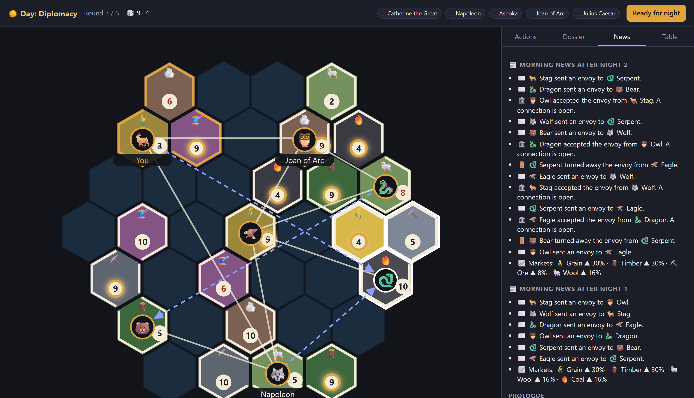

# 🎭 The World of Janus

**A hidden-identity diplomacy game for 3–8 friends, played in the browser over Discord.** Named for Janus, the two-faced Roman god: everyone shows the table one face and plays the board with another.

Everyone knows who's at the table. Nobody knows who rules which city on the map. By day you trade and sell in the open. By night you send envoys, open supply lines, build factories and spy on treasuries, and the morning news reports every move by city, never by player. Work out who your real allies are before you fund your enemy.



## How a round works

| Phase | What happens | Who sees it |
|---|---|---|
| ☀️ **Harvest** | A 12-sided die decides which tiles produce. Supply lines share goods between partners. | Your hand is private |
| ☀️ **Day: Diplomacy** | Trade with players, sell at the market, and vote at the Tribunal to expose a suspect. | Public, signed with your name |
| 🌙 **Night: Under the Table** | Send envoys, open supply lines, build factories, spy on a city's treasury. | Secret |
| 📰 **Morning news** | Every night action, reported by city, plus market moves. | Everyone, but without names |

Each city produces only 3 of 7 resources, and night actions need specific cards, so most players must trade in public to act. Trade for Grain and Wool today, and people will guess you sent tonight's envoy.

**Factions.** **The Syndicate** knows its own members, has the black market to itself, and wants to stay hidden. The **Concord** must expose every Syndicate member at the Tribunal. Anyone who builds 7 supply lines earns the secret **🟡 Free Trader** title, which can veto the Tribunal. Unruled bot cities fill out the map, so even a 3-player game has plenty to work out.

Full rules, design decisions and the roadmap are in [DESIGN.md](DESIGN.md).

## How it's built

- **No game server.** The site is static on GitHub Pages. The host's browser runs the authoritative game and talks to the other players peer-to-peer over WebRTC ([boardgame.io](https://boardgame.io) + PeerJS).
- **Hidden information is filtered by the host.** Each player's browser only receives that player's view of the game, so other players' identities and hands never reach it.
- **React + TypeScript**, with an SVG hex map generated fresh each game.
- **Tested by simulation:** full games at several player counts, plus checks that secrets stay secret (`npm test`).

```
src/game/   rules engine: setup, phases, moves, bots, per-player views
src/ui/     React board, hex map, panels
src/net/    room links, seats and credentials
```

## Running it

```bash
npm install
npm run dev      # local dev server
npm test         # simulated games
npm run build    # production build in dist/
```

**Practice on one screen** on the home page lets you play every seat yourself, with no network needed.

## Playing with friends

1. Open the deployed site and choose **Host a game**.
2. Tick who's playing, click **Create room**, and paste the invite link in Discord.
3. Friends open the link and pick their name. Keep your tab open: the host's browser *is* the server.

The player list comes from [src/config.ts](src/config.ts). Every tunable number lives in [src/game/constants.ts](src/game/constants.ts).

Pushes to `main` deploy automatically through GitHub Actions (Settings → Pages → Source: **GitHub Actions**).
